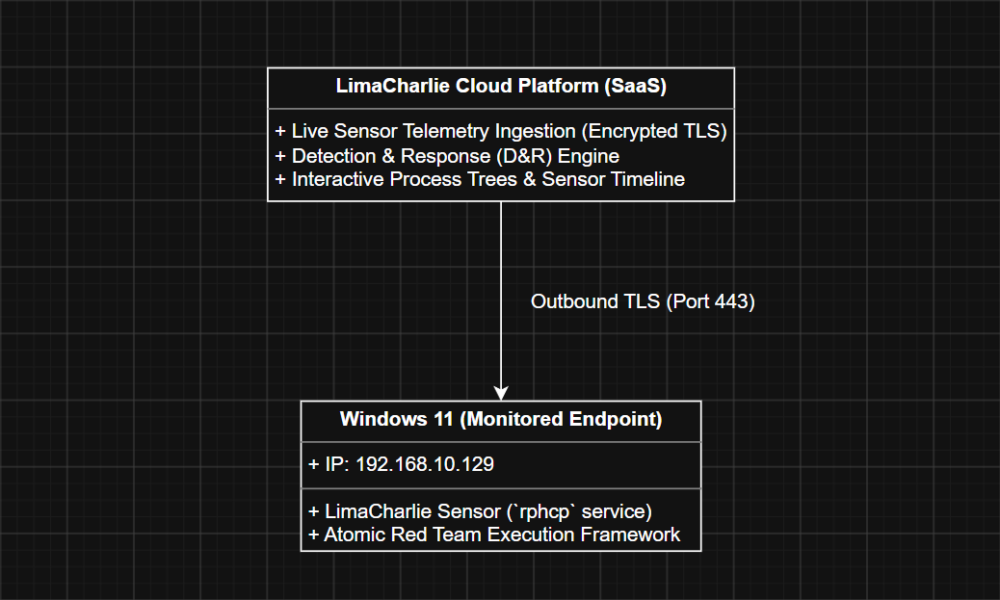

# Lab Architecture & Network Setup

* **EDR Cloud Tenant:** LimaCharlie SaaS organization configured with real-time detection routing.
* **Target Endpoint:** Windows 11 Enterprise VM (`DESKTOP-LQRC88Q`) running the 64-bit LimaCharlie sensor (`rphcp` kernel-level service).
* **Adversary Emulation Engine:** `Invoke-AtomicRedTeam` PowerShell framework coupled with native Living-Off-The-Land CLI executions.
