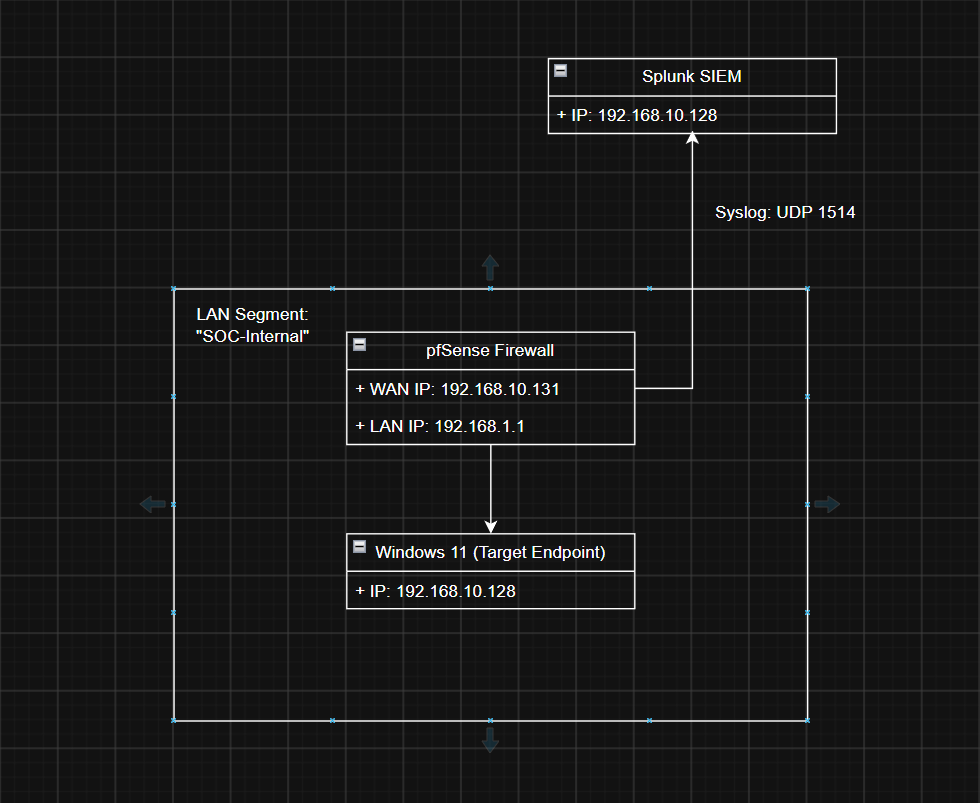

## Lab Architecture & Network Setup

* **WAN (`em0`):** Connected to VMware NAT (`VMnet8`). 
	* Receives DHCP address `192.168.10.131` and routes external traffic while providing a path to the Ubuntu Splunk server on the same subnet (`192.168.10.128`).
* **LAN (`em1`):** 
	* Connected to an isolated virtual switch (`SOC-Internal`). 
	* Acts as the default gateway (`192.168.1.1`) and DHCP server for the internal network.
* **Internal Workstation:** 
	* Windows 11 VM placed strictly on the `SOC-Internal` segment (`192.168.1.100`). 
	* All inbound and outbound packets are subject to pfSense stateful inspection.