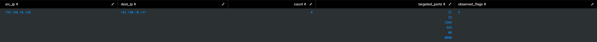

# Scenario 1: External Port Reconnaissance & TCP Flag Analysis

## The Simulation

Simulating an external adversary probing the perimeter firewall, I launched an automated TCP port scan from the external Ubuntu VM (`192.168.10.128`) targeting common service ports (`21`, `22`, `80`, `443`, `3389`, `8080`) on pfSense's WAN interface (`192.168.10.131`):

```bash
for port in 21 22 80 443 3389 8080; do
    nc -z -v -w 1 192.168.10.131 $port 2>/dev/null
done
```
## The Detection Query (Splunk)

```spl
index="endpoint" "filterlog"
| makemv delim="," _raw
| eval 
    action=mvindex(_raw, 5),
    direction=mvindex(_raw, 6),
    proto=mvindex(_raw, 14),
    src_ip=mvindex(_raw, 16),
    dest_ip=mvindex(_raw, 17),
    dest_port=mvindex(_raw, 19),
    tcp_flags=mvindex(_raw, 21)
| search action="block" direction="in" proto="tcp"
| stats count, values(dest_port) as targeted_ports, values(tcp_flags) as observed_flags by src_ip, dest_ip
```
## Telemetry Findings

* **Source IP:** `192.168.10.128` (External scanner host)
* **Destination IP:** `192.168.10.131` (pfSense WAN)
* **Targeted Ports:** Aggregated array of `21, 22, 80, 443, 3389, 8080`
* **Observed Flag:** `S` (SYN packet)
* **Analyst Evaluation:** 
	* The presence of isolated SYN (`[S]`) packets without subsequent ACK handshakes confirms an external port discovery sweep. 
	* Because pfSense enforces a stateful default-deny posture on the WAN interface, unsolicited inbound handshake attempts were dropped before establishing connection state.
