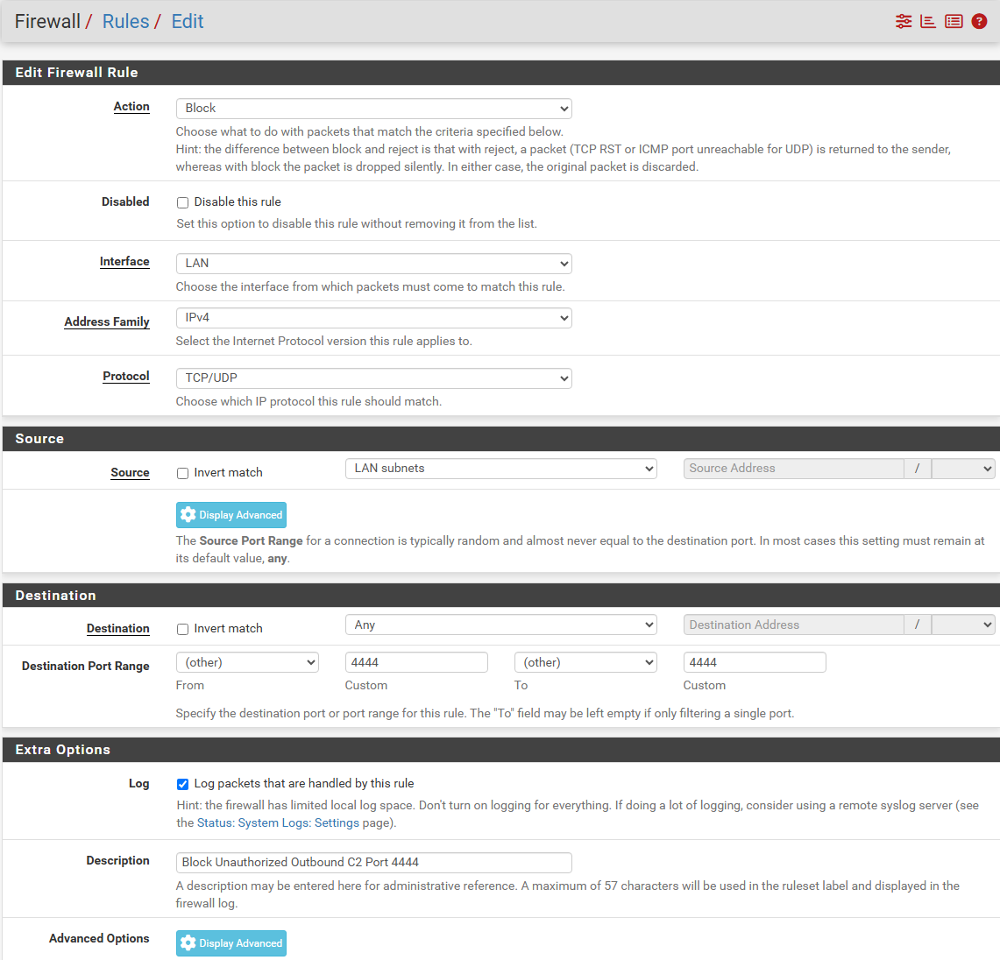
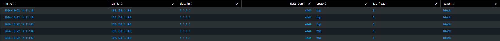

# Scenario 2: Egress Policy Violation (Unauthorized Outbound Exfiltration)

## The Simulation

To prevent unauthorized C2 channels or data exfiltration over non-standard services, I configured an egress filter at the top of the LAN interface blocking outbound TCP traffic on port `4444`. 


From the Windows workstation (`192.168.1.100`), I simulated an adversary attempting an outbound TCP socket connection:
```powershell
Test-NetConnection -ComputerName 1.1.1.1 -Port 4444 -InformationLevel Quiet
```
## The Detection Query (Splunk)

```spl
index="endpoint" "filterlog" "4444"
| makemv delim="," _raw
| eval 
    action=mvindex(_raw, 5),
    proto=mvindex(_raw, 14),
    src_ip=mvindex(_raw, 16),
    dest_ip=mvindex(_raw, 17),
    dest_port=mvindex(_raw, 19),
    tcp_flags=mvindex(_raw, 21)
| search action="block" dest_port="4444"
| table _time, src_ip, dest_ip, dest_port, proto, tcp_flags, action
```
## Telemetry Findings

* The table output recorded 4 sequential block entries within a few seconds.
* **Why 4 entries appeared:** 
	* In accordance with the RFC TCP connection standard, when an initial SYN packet is dropped silently without receiving an ACK or RST reply, the Windows networking stack retransmits the SYN packet up to 3 additional times before timing out.
* **Analyst Evaluation:** 
	* Immediate correlation opportunity. 
	* If a perimeter firewall logs an egress drop on port 4444 from an internal host, a SOC analyst pivots directly to EDR telemetry on that host at that exact timestamp to locate the PID and binary (`powershell.exe`) that created the raw network socket.
