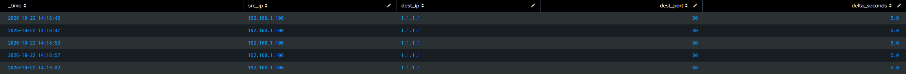

# Scenario 3: Automated C2 Beaconing Detection (Time-Delta Analytics)

## The Simulation

Adversaries use automated staging tools (Cobalt Strike, Mythic, or custom loaders) that periodically "beacon" outbound to external servers to retrieve tasks. 

Unlike human browsing, automated beacons communicate at predictable, uniform intervals.

On the Windows VM, I simulated an automated malware beacon issuing outbound HTTP requests to an external server on a strict 5-second sleep interval:

```powershell
1..6 | ForEach-Object {
    Write-Host "Sending beacon #$_..."
    Test-NetConnection -ComputerName 1.1.1.1 -Port 80 -InformationLevel Quiet | Out-Null
    Start-Sleep -Seconds 5
}
```
## The Mathematical Time-Delta Query (Splunk)

To uncover the beaconing signature, I built an analytical query using `streamstats` to measure the exact time variance between consecutive connections:
```spl
index="endpoint" "filterlog"
| makemv delim="," _raw
| eval 
    action=mvindex(_raw, 5),
    src_ip=mvindex(_raw, 16),
    dest_ip=mvindex(_raw, 17),
    dest_port=mvindex(_raw, 19)
| search src_ip="192.168.1.100" dest_ip="1.1.1.1" dest_port="80"
| sort 0 _time
| streamstats current=f last(_time) as prev_time by src_ip, dest_ip
| eval delta_seconds = round(_time - prev_time, 1)
| where isnotnull(delta_seconds)
| table _time, src_ip, dest_ip, dest_port, delta_seconds
```
### How the SPL Pipeline Works:
1. `sort 0 _time`: Orders all events chronologically so the previous event is guaranteed to be the immediate predecessor in real time.
2. `streamstats current=f last(_time) as prev_time by src_ip, dest_ip`: Steps through events one by one, storing the timestamp of the *previous* connection on the current event without looking at the current row's timestamp (`current=f`).
3. `eval delta_seconds = round(_time - prev_time, 1)`: Calculates the elapsed time between requests.
4. `where isnotnull(delta_seconds)`: Discards the first row (which has no predecessor).¡
## Telemetry Findings



* **Analyst Evaluation:** 
	* Standard human browsing shows wide, erratic deltas (`1.4s`, `28.2s`, `115.0s`, `4.8s`). 
	* Seeing five consecutive connections to the same IP with a near-zero variance provides definitive statistical evidence of an automated background process or malicious C2 loop.